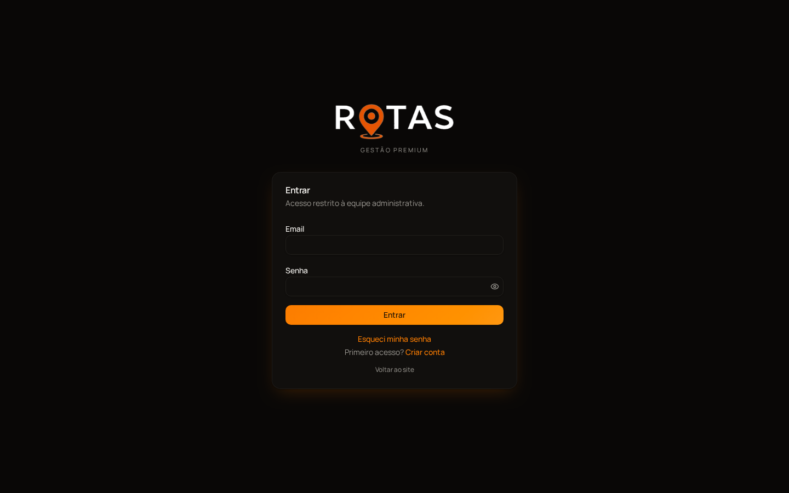
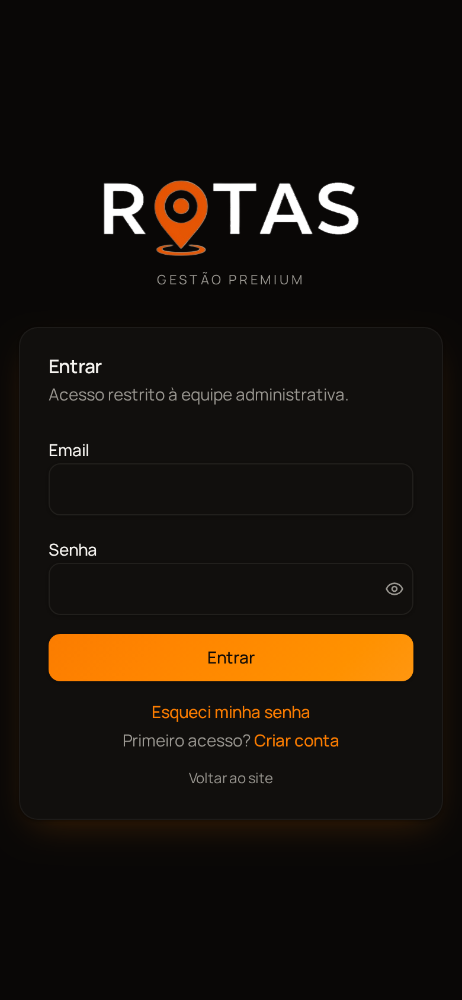

<div align="center">

# Rotas — Gestão Administrativa e Financeira

Sistema web interno para o controle administrativo e financeiro de um grupo de empresas do setor de viagens: contratos, recebíveis, despesas, contas bancárias, cadastros de parceiros e relatórios gerenciais em um só lugar.

**[Acessar a aplicação](https://rotas.lat)** · [Funcionalidades](docs/FUNCIONALIDADES.md) · [Arquitetura](docs/ARQUITETURA.md) · [Banco de dados](docs/BANCO_DE_DADOS.md) · [Segurança](docs/SEGURANCA.md)

</div>

---

## Sumário

- [Sobre o projeto](#sobre-o-projeto)
- [Problema que resolve](#problema-que-resolve)
- [Principais funcionalidades](#principais-funcionalidades)
- [Capturas de tela](#capturas-de-tela)
- [Demonstração](#demonstração)
- [Tecnologias](#tecnologias)
- [Estrutura de pastas](#estrutura-de-pastas)
- [Como executar localmente](#como-executar-localmente)
- [Variáveis de ambiente](#variáveis-de-ambiente)
- [Scripts disponíveis](#scripts-disponíveis)
- [Testes](#testes)
- [Documentação complementar](#documentação-complementar)

---

## Sobre o projeto

O **Rotas** é uma aplicação full-stack, em português do Brasil, usada pela equipe administrativa para registrar e acompanhar toda a operação financeira das empresas do grupo. Cada lançamento pode ser vinculado a uma **empresa**, a uma **missão** (projeto/viagem) e a uma **conta bancária**, o que permite consolidar resultados por qualquer um desses recortes.

O sistema funciona no navegador do computador e do celular e pode ser instalado como aplicativo (PWA).

## Problema que resolve

Antes do sistema, o controle financeiro de várias empresas e missões ficava espalhado em planilhas, o que dificultava:

- saber quanto ainda há para **receber** e **pagar** em um período;
- acompanhar **parcelas**, **pagamentos parciais** e **atrasos**;
- dividir uma mesma despesa entre **várias missões** (rateio);
- gerar **relatórios confiáveis** filtrados por empresa, missão, status e forma de pagamento;
- manter **histórico** de alterações e **cópias de segurança** dos dados.

O Rotas centraliza essas informações com regras de cálculo consistentes entre telas, dashboard e arquivos exportados.

## Principais funcionalidades

| Área | O que faz |
|------|-----------|
| **Dashboard** | Indicadores de contratado, recebido, a receber, despesas, lucro líquido e pendências em atraso; gráficos de entradas x saídas e despesas por categoria. |
| **Contratos** | Cadastro com entrada e parcelas; gera e sincroniza automaticamente os recebíveis correspondentes. |
| **Recebíveis** | Parcelas a receber, baixa total ou parcial, abatimentos (reembolso, comissão, desconto) com valor original, abatimentos e valor líquido separados. |
| **Despesas** | Lançamentos únicos ou parcelados, rateio entre missões, débito em conta, histórico de pagamentos e anexos. |
| **Bancos e Empresas** | Contas bancárias, múltiplas contas por empresa, dados de sócios e endereço. |
| **Cadastros** | Missões, funcionários, prestadores de serviço (MEI), consolidadoras e fornecedores. |
| **Lucros e Fluxo de Caixa** | Resultado por período e movimentações financeiras. |
| **Relatórios** | Exportação em PDF e Excel (`.xlsx`) respeitando exatamente os filtros da tela, com totais do período e logo da empresa. |
| **Filtros** | Seleção múltipla de empresas e missões, período, status e forma de pagamento; busca sem diferenciar acentos e maiúsculas. |
| **Backup e restauração** | Backup completo dos dados do usuário (incluindo arquivos), agendamento automático, download e restauração com cópia de segurança prévia. |
| **Assistente de IA** | Chat, transcrição de áudio e extração de registros a partir de arquivos e imagens para importação assistida. |
| **Acesso** | Login por e-mail e senha, recuperação de senha, perfis de acesso (admin, financeiro, visualizador) e encerramento automático por inatividade. |

Detalhes de cada módulo em [docs/FUNCIONALIDADES.md](docs/FUNCIONALIDADES.md).

## Capturas de tela

As telas internas exibem dados financeiros reais de clientes e, por isso, não foram incluídas. As imagens abaixo são da tela pública de acesso.

| Desktop | Mobile |
|:-------:|:------:|
|  |  |

## Demonstração

- **Aplicação em produção:** https://rotas.lat

> O acesso é restrito à equipe administrativa. Sem uma conta autorizada, apenas a tela de login fica visível.

## Tecnologias

**Front-end**

- [React 19](https://react.dev) + [TypeScript](https://www.typescriptlang.org)
- [TanStack Start](https://tanstack.com/start) (SSR e funções de servidor) e [TanStack Router](https://tanstack.com/router) (rotas baseadas em arquivos)
- [TanStack Query](https://tanstack.com/query) para cache e sincronização de dados
- [Tailwind CSS v4](https://tailwindcss.com) + componentes [shadcn/ui](https://ui.shadcn.com) sobre [Radix UI](https://www.radix-ui.com)
- [Recharts](https://recharts.org) (gráficos), [React Hook Form](https://react-hook-form.com) + [Zod](https://zod.dev) (formulários e validação), [date-fns](https://date-fns.org)
- [jsPDF](https://github.com/parallax/jsPDF) + jspdf-autotable (PDF) e [SheetJS](https://sheetjs.com) (Excel)

**Back-end e infraestrutura**

- [Vite 7](https://vitejs.dev) como ferramenta de build
- Execução no servidor em ambiente compatível com Cloudflare Workers
- [Lovable Cloud](https://lovable.dev) (baseado em [Supabase](https://supabase.com)): PostgreSQL, autenticação, armazenamento de arquivos e Realtime
- Segurança por linha (RLS) no PostgreSQL, funções e gatilhos em PL/pgSQL
- `pg_cron` para backups agendados
- Lovable AI Gateway (API compatível com OpenAI) para os recursos de IA
- Servidor MCP próprio com ferramentas de consulta somente leitura

**Qualidade**

- [Vitest](https://vitest.dev), ESLint e Prettier

## Estrutura de pastas

```text
.
├── docs/                      # Documentação complementar e capturas de tela
├── public/                    # Ícones, manifesto PWA e arquivos estáticos
├── src/
│   ├── assets/                # Referência da logo do sistema
│   ├── components/            # Componentes de interface e de domínio
│   │   ├── ai-assistant/      # Chat, importação e utilidades do assistente de IA
│   │   └── ui/                # Componentes base (shadcn/ui)
│   ├── hooks/                 # Hooks React reutilizáveis
│   ├── integrations/supabase/ # Clientes do banco, tipos gerados e middleware de autenticação
│   ├── lib/                   # Regras de negócio, cálculos, exportação, backup e testes
│   │   ├── ai/                # Acesso ao gateway de IA (somente servidor)
│   │   └── mcp/               # Servidor MCP e suas ferramentas
│   ├── routes/                # Páginas e endpoints (roteamento por arquivos)
│   │   ├── _app.*.tsx         # Telas autenticadas (dashboard, módulos, admin)
│   │   └── api/               # Endpoints HTTP (IA, versão, backup agendado)
│   ├── router.tsx             # Criação do roteador e do QueryClient
│   ├── server.ts              # Entrada do servidor
│   ├── start.ts               # Middlewares globais
│   └── styles.css             # Tema (tokens de cor, tipografia) e Tailwind
├── supabase/
│   ├── migrations/            # Histórico de migrações do banco
│   └── migracao-externa/      # Scripts para recriar o banco em outro projeto Supabase
├── drizzle/                   # Esquema e migração gerados pelo drizzle-kit
├── .env.example               # Modelo de variáveis de ambiente
├── package.json
└── vite.config.ts
```

Mais detalhes em [docs/ARQUITETURA.md](docs/ARQUITETURA.md).

## Como executar localmente

### Pré-requisitos

- [Bun](https://bun.sh) 1.x (o projeto usa `bun.lock`)
- Um projeto Supabase com o esquema deste repositório aplicado (veja [docs/BANCO_DE_DADOS.md](docs/BANCO_DE_DADOS.md))

### Passo a passo

```bash
# 1. Clone o repositório
git clone <url-do-repositorio>
cd <pasta-do-repositorio>

# 2. Instale as dependências
bun install

# 3. Configure as variáveis de ambiente
cp .env.example .env
# edite o .env com os dados do seu projeto Supabase

# 4. Inicie o servidor de desenvolvimento
bun run dev
```

A aplicação ficará disponível no endereço exibido pelo Vite no terminal.

### Preparando o banco

Para um banco novo, há dois caminhos:

1. **Migrações:** aplique, em ordem, os arquivos de `supabase/migrations/` (por exemplo com a [Supabase CLI](https://supabase.com/docs/guides/cli)).
2. **Scripts consolidados:** execute os arquivos `01` a `09` de `supabase/migracao-externa/` no SQL Editor, seguindo o [README da pasta](supabase/migracao-externa/README.md).

O primeiro usuário cadastrado recebe automaticamente o perfil de administrador.

## Variáveis de ambiente

Copie `.env.example` para `.env` e preencha:

| Variável | Onde é usada | Descrição |
|----------|--------------|-----------|
| `VITE_SUPABASE_URL` | Navegador | URL do projeto Supabase |
| `VITE_SUPABASE_PUBLISHABLE_KEY` | Navegador | Chave pública (anon/publishable) |
| `VITE_SUPABASE_PROJECT_ID` | Navegador | ID do projeto (usado pelo servidor MCP) |
| `SUPABASE_URL` | Servidor | URL do projeto Supabase |
| `SUPABASE_PUBLISHABLE_KEY` | Servidor | Chave pública (anon/publishable) |
| `SUPABASE_SERVICE_ROLE_KEY` | Servidor | Chave privada para operações administrativas e backups — **nunca** exponha |
| `LOVABLE_API_KEY` | Servidor | Chave do gateway de IA — necessária apenas para os recursos de IA |

Somente variáveis com prefixo `VITE_` chegam ao navegador. As demais são lidas apenas no servidor.

## Scripts disponíveis

| Comando | Descrição |
|---------|-----------|
| `bun run dev` | Servidor de desenvolvimento |
| `bun run build` | Build de produção |
| `bun run build:dev` | Build em modo de desenvolvimento |
| `bun run preview` | Pré-visualização do build |
| `bun run lint` | Análise estática com ESLint |
| `bun run format` | Formatação com Prettier |

## Testes

Há testes unitários com Vitest para as regras de relatórios financeiros (escopo por data de vencimento, pagamentos parciais) e para a ordenação cronológica:

```bash
bunx vitest run
```

Arquivos: `src/lib/financial-report.test.ts` e `src/lib/sort-vencimento.test.ts`.

## Documentação complementar

| Documento | Conteúdo |
|-----------|----------|
| [docs/FUNCIONALIDADES.md](docs/FUNCIONALIDADES.md) | Descrição de cada módulo e das regras de negócio |
| [docs/ARQUITETURA.md](docs/ARQUITETURA.md) | Camadas, fluxo de dados, autenticação e integrações |
| [docs/BANCO_DE_DADOS.md](docs/BANCO_DE_DADOS.md) | Tabelas, perfis de acesso, segurança por linha e armazenamento |
| [docs/SEGURANCA.md](docs/SEGURANCA.md) | Práticas de segurança e cuidados com credenciais |
| [supabase/migracao-externa/README.md](supabase/migracao-externa/README.md) | Como recriar o banco em outro projeto Supabase |

---

<div align="center">
Desenvolvido com React, TypeScript e TanStack Start.
</div>
